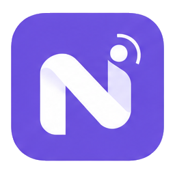
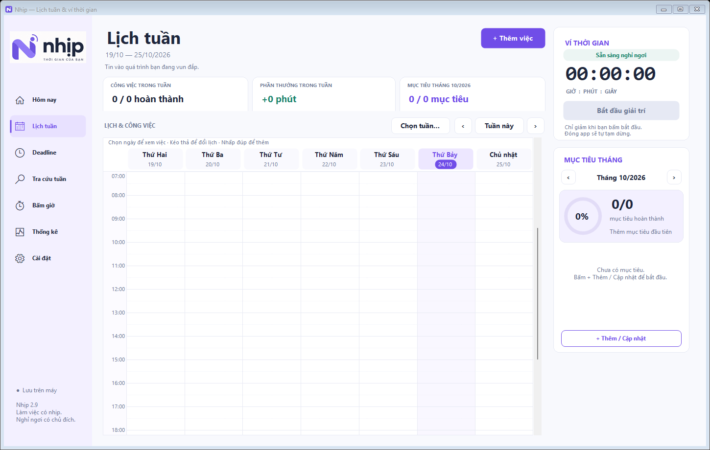

<p align="center">
  
</p>

# Nhịp — Lịch tuần & ví thời gian

Ứng dụng Windows giúp lên lịch công việc, quản lý deadline, bấm giờ tập trung và dành thời gian giải trí có chủ đích.

**Phiên bản: 2.9 · C# · Windows Forms · .NET Framework 4.x**

Nhịp chạy trên máy, không yêu cầu tài khoản hoặc kết nối Internet. Bản phát hành sạch bắt đầu với **0 công việc, 0 deadline, 0 mục tiêu, 0 phiên tập trung và 0 phút trong ví**.



## Tính năng

- **Hôm nay:** danh sách việc trong ngày và việc chưa xong từ các ngày trước.
- **Lịch tuần:** kéo thả đổi lịch, kéo chỉnh thời lượng, đánh dấu hoàn thành, sao chép và đổi màu block.
- **Deadline:** chia một mục tiêu lớn thành việc nhỏ; gắn việc có sẵn, theo dõi tiến độ và xác nhận bàn giao riêng.
- **Đưa việc từ Deadline vào lịch:** chọn deadline trước, chọn việc sau; chuyển lịch của việc đã có thay vì tạo bản trùng.
- **Bấm giờ:** chọn task chưa hoàn thành hoặc nhập tên phiên, tạm dừng/tiếp tục, lưu lịch sử thời gian thực.
- **Ví thời gian:** hoàn thành công việc để nhận phút thưởng; chỉ trừ khi bắt đầu giải trí. Bỏ hoàn thành sẽ thu hồi đúng phần thưởng đã nhận.
- **Mục tiêu tháng:** vòng tiến độ, nhóm chưa hoàn thành/đã hoàn thành, thu gọn nhóm và chỉnh sửa chỉ tiêu.
- **Thống kê:** xem một ngày, nhiều ngày, theo tuần/tháng; chi tiết phiên tập trung, công việc và giao dịch ví.
- **Lưu cục bộ:** dữ liệu JSON, lưu tệp qua bước thay thế và bản sao lưu `.bak`.

## Chạy ứng dụng

1. Giải nén gói chạy vào một thư mục có quyền ghi.
2. Mở `Nhip.exe`.
3. Thêm công việc đầu tiên. Ví thời gian mặc định bằng 0; hoàn thành việc để nhận phần thưởng đã đặt.

Nếu lấy mã nguồn từ repository, hãy build theo hướng dẫn bên dưới. Gói chạy sẵn có thể được đính kèm trong mục **Releases** của repository.

Ứng dụng lưu dữ liệu tại `data/nhip.json` bên cạnh tệp thực thi. Thư mục này được tạo tự động khi chạy; tệp dữ liệu được tạo khi lưu thay đổi đầu tiên. Bản sao này dùng thư mục dữ liệu riêng, không đọc dữ liệu của ứng dụng ở thư mục khác.

## Build từ mã nguồn

Cần Windows, PowerShell và trình biên dịch .NET Framework ở đường dẫn hệ thống `Microsoft.NET\Framework64\v4.0.30319\csc.exe`. Script kiểm tra sự hiện diện của trình biên dịch trước khi build.

Mở PowerShell trong thư mục repository:

```powershell
powershell -NoProfile -ExecutionPolicy Bypass -File .\build.ps1
.\Nhip.exe
```

Để đổi tên tệp đầu ra:

```powershell
.\build.ps1 -OutputName Nhip-custom.exe
```

Không cần tải thư viện NuGet cho quá trình build hiện tại. Logo và biểu tượng được nhúng vào tệp thực thi.

## Kiểm tra

Sau khi build:

```powershell
# Kiểm tra dữ liệu, giao dịch phần thưởng, deadline và thống kê
.\verification\Tests.exe

# Kiểm tra giao diện với thư mục dữ liệu thử riêng
.\Nhip.exe --ui-test
Get-Content .\verification\ui-tests.txt -Tail 1
```

Kiểm tra giao diện có mở các cửa sổ thử. Kết quả chi tiết nằm trong `verification/ui-tests.txt`; hãy kiểm tra dòng kết luận thay vì chỉ dựa vào mã thoát của ứng dụng giao diện.

Các chế độ minh họa dùng dữ liệu giả trong `verification/`, tách biệt với `data/`:

```powershell
.\Nhip.exe --preview
.\Nhip.exe --today-preview
.\Nhip.exe --deadline-preview
```

Không dùng các cờ trên khi chỉ muốn mở ứng dụng với dữ liệu trống. Không có dữ liệu minh họa được thêm tự động trong chế độ chạy bình thường.

## Cấu trúc

```text
assets/                  Logo, biểu tượng PNG và ICO
docs/images/             Ảnh giao diện bản khởi đầu trống
src/                     Mã nguồn ứng dụng
tests/                   Kiểm tra dữ liệu và các tình huống hồi quy
tools/build_app_icon.py  Tạo lại ICO từ ảnh thương hiệu gốc
build.ps1                Build ứng dụng và chương trình kiểm tra
data.example.json        Mẫu dữ liệu mặc định, hoàn toàn trống
HUONG_DAN.md             Hướng dẫn sử dụng
```

Script tạo lại icon cần Python và Pillow; chúng không cần thiết để build/chạy ứng dụng vì tài nguyên icon đã được cung cấp sẵn.

## Dữ liệu và các quy tắc cần biết

- Sao lưu **toàn bộ thư mục `data/`** khi muốn chuyển sang máy/thư mục khác.
- Bản sạch không chứa dữ liệu cá nhân, lịch sử sử dụng, bản sao lưu hoặc ảnh chụp từ bản đang dùng.
- `.gitignore` bỏ qua dữ liệu chạy thật, các tệp phục hồi `nhip.json*`, thư mục kiểm tra và tệp build.
- `data.example.json` là tài liệu mẫu, không được tự động dùng để ghi đè dữ liệu khi mở app.
- Lưu một phiên tập trung không tự tick hoàn thành task và không cộng thưởng. Chọn task hiện lấy tên cho phiên; ứng dụng chưa có báo cáo tổng giờ theo mã task.
- Thống kê công việc của ngày trước phản ánh trạng thái hoàn thành hiện tại. Thời gian phiên qua nửa đêm được chia vào từng ngày; dữ liệu giải trí cũ được phân bổ gần đúng theo mốc lưu.
- Khi ví đang trừ hoặc phiên tập trung đang chạy, đóng app bình thường để lưu/tạm dừng.


